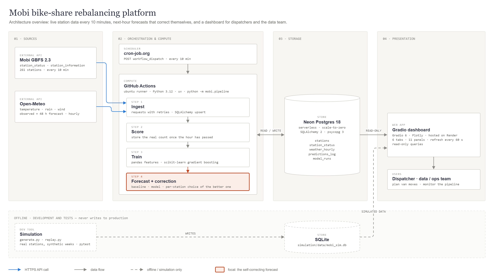

# Mobi bike-share rebalancing dashboard

[](https://github.com/chrisho251/mobi-bike-share-analytics-dashboard/actions/workflows/pipeline.yml)


Next-hour bike availability forecasts and rebalancing suggestions for
[Mobi by Rogers](https://www.mobibikes.ca/), Vancouver's bike-share system.

Bike-share stations drift out of balance during the day: commuters empty the
residential stations in the morning and fill Downtown, then reverse it in the
evening. A dispatcher with a van can only fix a few stations an hour, so they
need to know which ones will run empty or full next. This project collects
the state of all 261 stations every 10 minutes, forecasts each station's bike
count one hour ahead, checks every forecast against what happened, and turns
the result into a list of bike moves.



## What it does

- **Collects** the Mobi GBFS feed every 10 minutes and Open-Meteo weather every
  hour into Postgres. Writes are idempotent, so a repeated run never creates
  duplicates.
- **Forecasts** the bikes at every station 60 minutes ahead, three ways: a
  persistence baseline (no change), a gradient-boosted model, and a corrected
  forecast that uses the model only at stations where it beat the baseline
  over the last 24 hours.
- **Scores itself.** One hour after each forecast, the observed count is
  stored next to it, and the dashboard tracks the error per hour, per area and
  per training run.
- **Suggests moves.** Stations forecast to drop below 15 % full are topped up
  from the nearest stations with spare bikes, within 2 km.
- **Runs offline** on a simulated network with real station locations, so the
  dashboard and the forecasting code can be explored without credentials.

## Dashboard

Six tabs, refreshed every minute:

| Tab | For | Shows |
|---|---|---|
| Live Overview | dispatcher | station map coloured by fill level; empty and full stations over 24 h |
| Next-Hour Actions | dispatcher | suggested bike moves; stations at risk in the next hour |
| Forecast Accuracy | data team | error of the three forecasts per hour and per area; held-out error of each training run |
| Station Explorer | both | one station's bikes over 24 h with the forecasts made an hour earlier |
| Demand Patterns | planning | fill level by area and hour of day; activity in dry and rainy hours |
| Monitoring | operations | status tiles (data age, completeness, stations, weather, model, scoring); data collected per day; stations reporting |

## Quick start

```bash
git clone https://github.com/chrisho251/mobi-bike-share-analytics-dashboard.git
cd mobi-bike-share-analytics-dashboard
uv sync --all-extras

uv run python simulation/generate.py   # synthetic history, ~20 s
uv run python simulation/replay.py     # forecasts and scores, ~6 min
uv run python -m mobi.app              # http://localhost:7860
```

This runs everything on simulated data. [INSTALL.md](INSTALL.md) covers pip
installation, live data and troubleshooting.

## Configuration

| Variable | Default | Purpose |
|---|---|---|
| `DATABASE_URL` | the simulation database | Postgres (`postgresql://...`) or SQLite (`sqlite:///path.db`). Read from the environment or from `.env.local`. Setting it switches every component to that database. |
| `PORT` | `7860` | Port of the dashboard. |

The collector (`python -m mobi.pipeline`) refuses to run against the
simulation database, so live and synthetic data never mix.

## Deployment

All services below have free tiers.

| Part | Service | Setup |
|---|---|---|
| Database | [Neon](https://neon.tech) Postgres | Create a project and copy the pooled connection string. |
| Pipeline | GitHub Actions (`.github/workflows/pipeline.yml`) | Add the repository secret `DATABASE_URL`. |
| Schedule | [cron-job.org](https://cron-job.org) | Every 10 minutes, `POST https://api.github.com/repos/<owner>/<repo>/actions/workflows/pipeline.yml/dispatches` with body `{"ref":"main"}` and headers `Authorization: Bearer <token>` and `Accept: application/vnd.github+json`. Use a fine-grained token scoped to this repository with *Actions: read and write* only. |
| Dashboard | [Render](https://render.com) web service | Build command `pip install -r requirements.txt`, start command `python -m mobi.app`, environment variable `DATABASE_URL` (a read-only database role is recommended). |

The workflow also has its own cron schedule as a fallback. GitHub does not
guarantee scheduled runs, and on this repository they arrived hours late,
which is why an external trigger is used.

## How the forecast works

The model predicts the change in bikes over the next hour from the current
count, the counts 30 and 60 minutes earlier, the local hour and weekday, the
weather now and in one hour, and the station's location and area. It is a
scikit-learn `HistGradientBoostingRegressor` with absolute-error loss: most
stations do not change within an hour, and a median-predicting model falls
back to "no change" where it finds no signal. Early stopping sizes the model to
the data available. The pipeline retrains it whenever a new snapshot arrives.

The corrected forecast is chosen per station from the last 24 hours of scored
forecasts: the model where its error was lower than the baseline's, the
baseline elsewhere. A station where the model keeps failing is handed back to
the baseline automatically. Adding each station's recent mean error to the
model was tested first and rejected, because it raised the error from 0.66 to
0.88 bikes. [docs/architecture.md](docs/architecture.md) has the details.

## Results

Mean absolute error in bikes, 60 minutes ahead; lower is better.

**Simulated network**, 21 days replayed as if live, with the model retrained
daily. The gain over the baseline grows as history accumulates:

| Week | Baseline | Model | Corrected | Corrected vs baseline |
|---|---|---|---|---|
| 1 | 1.120 | 1.082 | 1.081 | -3.5 % |
| 2 | 1.142 | 1.051 | 1.063 | -6.9 % |
| 3 | 1.149 | 1.041 | 1.050 | -8.6 % |

**Live network**, first two days of collection: 58 % of hourly changes are
zero and the baseline error is 0.42 bikes, so there is little to gain yet.
Early models were worse than the baseline (0.54); the correction kept the
logged forecast within about 1 % of it (0.43). Current models are level with
the baseline. The Forecast Accuracy tab shows the live numbers as data
accumulates.

## Project structure

```
src/mobi/
  config.py      endpoints, constants, database selection
  db.py          schema (5 tables), engine, upsert
  ingest.py      GBFS and Open-Meteo collection
  features.py    feature building (lags, target, calendar, weather)
  forecast.py    training, forecasting, correction, scoring
  pipeline.py    one collection and forecasting cycle (entry point)
  actions.py     rebalancing rules
  queries.py     read-only, cached dashboard queries
  app.py         Gradio dashboard (entry point)
simulation/      synthetic network generator and forecast replay
tests/           pytest suite
docs/            architecture, tech stack, simulation walkthrough
```

## Development

```bash
uv run pytest     # 13 tests on temporary SQLite databases, no network
```

After changing dependencies in `pyproject.toml`, refresh the lock file and the
pip requirements:

```bash
uv lock
uv export --format requirements-txt --all-extras --no-dev --no-hashes -o requirements.txt
```

[docs/tech-stack.md](docs/tech-stack.md) lists the libraries and why each was
chosen.

## Data sources

- Station data: Mobi by Rogers
  [GBFS feed](https://gbfs.kappa.fifteen.eu/gbfs/2.3/mobi/en/gbfs.json).
- Weather: [Open-Meteo](https://open-meteo.com/), licensed under
  [CC BY 4.0](https://creativecommons.org/licenses/by/4.0/).
- Map tiles: © [OpenStreetMap](https://www.openstreetmap.org/copyright)
  contributors.
