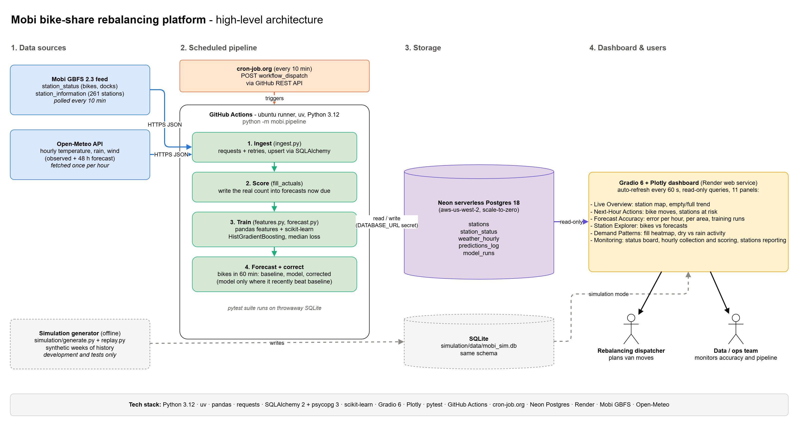

# Architecture

The platform turns two public feeds into next-hour bike forecasts and
rebalancing suggestions for Mobi by Rogers, Vancouver's bike-share system.
It has four layers, each a single responsibility.

## 1. Data sources

| Source | Content | Cadence |
|---|---|---|
| Mobi GBFS 2.3 feed (`gbfs.kappa.fifteen.eu`) | `station_status`: bikes and free docks per station; `station_information`: name, location, capacity | status every 10 min; station metadata hourly |
| Open-Meteo forecast API | Hourly temperature, precipitation and wind for downtown Vancouver, one day back and two days ahead | hourly |

Weather and station metadata change slowly, so they are fetched at most once
per hour. This also keeps the shared GitHub runner IPs under Open-Meteo's
free-tier rate limit.

## 2. Scheduled pipeline

`python -m mobi.pipeline` runs one cycle. GitHub's own cron proved unreliable
for a new repository (one run in ten hours), so an external scheduler,
cron-job.org, calls the GitHub REST API (`workflow_dispatch`) every 10
minutes with a fine-grained token limited to this repository's Actions.

Each cycle runs these steps in order. A failing step is logged and does not
stop the next; the run is marked failed unless only weather failed.

1. **Ingest** (`ingest.py`): download, normalise and upsert. Snapshots are
   keyed by station and feed timestamp, so repeated runs never duplicate rows.
2. **Score** (`forecast.fill_actuals`): for forecasts whose target time has
   passed, store the observed bike count (nearest snapshot within 5 minutes).
3. **Train** (`features.py`, `forecast.train_model`): build one feature row
   per station snapshot (current bikes, 30/60-minute lags, local hour and
   weekday, weather now and in one hour, location, area) and fit a
   gradient-boosted regressor of the change in bikes over the next hour.
4. **Forecast and correct** (`forecast.predict_next_hour`): log three
   forecasts per station.

### Forecasts and the correction step

| Forecast | Definition |
|---|---|
| Baseline | Bikes stay as they are now (persistence). |
| Model | Current bikes plus the model's predicted change, clipped to 0..capacity. |
| Corrected | The model at stations where it beat the baseline over the last 24 hours (at least 6 scored forecasts); the baseline elsewhere. |

The correction closes the loop between forecasts and outcomes: every forecast
is scored one hour later, and those scores decide, station by station, which
forecast is used next. A station where the model keeps failing is handed back
to the baseline automatically, and returned to the model once it improves.

Two alternatives were evaluated on real data and rejected:

- **Squared-error loss.** Most stations do not change within an hour (58 % of
  observations), and a mean-predicting model spread small changes everywhere:
  0.77 bikes error versus 0.65 for persistence. Absolute-error loss predicts
  the median change and matches persistence when there is no signal.
- **Additive bias correction** (adding each station's recent mean error):
  raised the error from 0.66 to 0.88 bikes, because the recent error is
  mostly noise when counts barely move.

## 3. Storage

Neon serverless Postgres 18, one database, five tables. All timestamps are
naive UTC; the dashboard converts to `America/Vancouver`.

| Table | Key | Written by | Notes |
|---|---|---|---|
| `stations` | `station_id` | ingest (overwrite) | name, lat, lon, capacity, area |
| `station_status` | `station_id`, `snapshot_time` | ingest (insert only) | immutable history |
| `weather_hourly` | `time` | ingest (overwrite) | forecasts are replaced by observations |
| `predictions_log` | `station_id`, `base_time` | forecast; `actual` filled by scoring | the evaluation record |
| `model_runs` | `model_version` | forecast | held-out error of model and baseline per training run |

The same schema runs on SQLite for tests and the simulation. When
`DATABASE_URL` is not set, every component uses the simulation database
(`simulation/data/mobi_sim.db`); setting it switches to live data. The
pipeline refuses to write live snapshots into the simulation database.

## 4. Dashboard

A Gradio app (`mobi.app`) reads the database only and refreshes every 60
seconds. Query results are cached for 30 seconds (live data) to 10 minutes
(seven-day analyses). Eleven panels in six tabs serve three audiences:

| Tab | Panels | Audience |
|---|---|---|
| Live Overview | station map by fill level; empty and full stations over 24 h | dispatcher |
| Next-Hour Actions | suggested moves; stations at risk | dispatcher |
| Forecast Accuracy | error per hour (7 days); error by area (24 h); training runs | data team |
| Station Explorer | one station's bikes and forecasts (24 h) | both |
| Demand Patterns | fill level by area and hour; activity in dry vs rainy hours | planning |
| Monitoring | status board (data age, completeness, stations, weather, model vs baseline, scoring backlog); hour-by-hour collection and scoring status; stations reporting per snapshot | operations |

Suggested moves follow three rules: a station is short when its corrected
forecast is under 15 % full; a donor is over 55 % full and keeps half its
capacity; each short station is topped up toward 30 % from the nearest donors
within 2 km.

## Simulation

`simulation/` generates weeks of synthetic history (real station locations,
commute and leisure patterns, rain effects, Poisson noise, rebalancing vans)
into a separate SQLite file, and replays the forecast loop over it exactly as
it runs live. It exists to develop and validate the forecasting code before
the live history is long enough. It never writes to the production database.
